<!-- ═══════════════ HERO ═══════════════ -->

  

  

  
  
  
  

  
  
  

<!-- ═══════════════ PROFESSIONAL SUMMARY ═══════════════ -->

  

  Software Engineering graduate and Full Stack Web Developer from Peshawar, Pakistan, specializing in the <b>MERN stack</b>. 
  I build responsive, secure, and maintainable web applications, from REST API design and authentication to polished, user-centered interfaces. 
  I have hands-on experience with Docker, CI/CD workflows, and collaborative Git-based development through two full-stack internships.

<table align="center">
  <tr>
    <td align="center" width="33%" valign="top">
      <h2>🎓</h2>
      <b>Education</b> 
      BS Software Engineering 
      Islamia College University, Peshawar 
      2022 – 2026
    </td>
    <td align="center" width="33%" valign="top">
      <h2>💻</h2>
      <b>Specialization</b> 
      Full Stack and 
      MERN Stack Development
    </td>
    <td align="center" width="33%" valign="top">
      <h2>🚀</h2>
      <b>Experience</b> 
      Full-stack internships at 
      SMIT and Software Synergy Solutions
    </td>
  </tr>
  <tr>
    <td align="center" valign="top">
      <h2>🔐</h2>
      <b>Security Focus</b> 
      JWT authentication, authorization, 
      and CSRF protection
    </td>
    <td align="center" valign="top">
      <h2>🧠</h2>
      <b>Strengths</b> 
      Problem-solving, clean code, 
      and continuous learning
    </td>
    <td align="center" valign="top">
      <h2>🎯</h2>
      <b>Seeking</b> 
      Junior Full Stack Developer and 
      Software Engineer opportunities
    </td>
  </tr>
</table>
<!-- ═══════════════ TECHNICAL EXPERTISE ═══════════════ -->

  

<table align="center">
  <tr>
    <td align="center" width="20%"><b>🎨 Frontend</b></td>
    <td align="center" width="40%"></td>
    <td width="40%">Responsive Web Design • Component-Based Architecture • Performance Optimization</td>
  </tr>
  <tr>
    <td align="center"><b>⚙️ Backend</b></td>
    <td align="center"></td>
    <td>RESTful API Development • JWT Authentication and Authorization • CSRF Protection</td>
  </tr>
  <tr>
    <td align="center"><b>🗄️ Databases</b></td>
    <td align="center"></td>
    <td>Database Management • Data Persistence</td>
  </tr>
  <tr>
    <td align="center"><b>💻 Languages</b></td>
    <td align="center"></td>
    <td>JavaScript • C++</td>
  </tr>
  <tr>
    <td align="center"><b>🔧 Tools</b></td>
    <td align="center"></td>
    <td>CI/CD Workflows • Application Deployment • Version Control with Git and GitHub</td>
  </tr>
</table>
<!-- ═══════════════ PROFESSIONAL EXPERIENCE ═══════════════ -->

  

<table align="center">
  <tr>
    <td width="50%" valign="top">
      <h3>🚀 Full Stack Web Developer Intern</h3>
      <b>Saylani Mass IT Training (SMIT) — Peshawar</b> 
      2026
      <ul>
        <li>Completed an intensive, project-based full-stack development program covering modern frontend and backend technologies.</li>
        <li>Built web applications end to end and collaborated with team members using Git and GitHub.</li>
        <li>Gained practical exposure to Docker, CI/CD workflows, and application deployment.</li>
        <li>Strengthened problem-solving, teamwork, and full-stack engineering skills.</li>
      </ul>
    </td>
    <td width="50%" valign="top">
      <h3>💻 Remote Software Development Intern</h3>
      <b>Software Synergy Solutions</b> 
      2026
      <ul>
        <li>Completed a three-month remote internship focused on practical web development.</li>
        <li>Contributed to frontend and backend development tasks across software projects.</li>
        <li>Collaborated with the team to deliver features and resolve technical challenges.</li>
        <li>Applied modern web development practices while advancing coding and problem-solving skills.</li>
      </ul>
    </td>
  </tr>
</table>
<!-- ═══════════════ FEATURED PROJECTS ═══════════════ -->

  

<table align="center">
  <tr>
    <td colspan="2" align="center" valign="top">
      <h3>🏥 AI Clinic Management System</h3>
      
A full-stack clinic management platform with role-based dashboards for <b>Admin, Doctor, Receptionist, and Patient</b>, covering clinic operations from appointment booking to prescriptions and reporting.

      

        
        
        
        
        
        
      

        
      
    </td>
  </tr>
  <tr>
    <td width="50%" align="center" valign="top">
      <h3>🚚 MK Transportation</h3>
      
A responsive logistics website presenting transportation services, company information, locations, and contact details with a clean, professional layout.

        
      
    </td>
    <td width="50%" align="center" valign="top">
      <h3>📊 Pollify — Online Polling Platform</h3>
      
An online polling platform where users can create polls, cast votes, and view results.

      

        
        
        
        
      

        
      
    </td>
  </tr>
</table>
<!-- ═══════════════ GITHUB ANALYTICS ═══════════════ -->

  

  
  

 

  

  

  <picture>
    <source media="(prefers-color-scheme: dark)" srcset="https://raw.githubusercontent.com/shayan368/shayan368/output/github-snake-dark.svg" />
    <source media="(prefers-color-scheme: light)" srcset="https://raw.githubusercontent.com/shayan368/shayan368/output/github-snake.svg" />
    
  </picture>

<!-- ═══════════════ ACHIEVEMENTS ═══════════════ -->

  

  

<!-- ═══════════════ CONNECT ═══════════════ -->

  

  I am actively seeking Junior Full Stack Developer and Software Engineer opportunities, 
  and I welcome conversations about collaboration, projects, and new roles.

  
  
  

  🌐 Portfolio: <a href="https://shayanahmad.vercel.app">shayanahmad.vercel.app</a>

  

  

 
